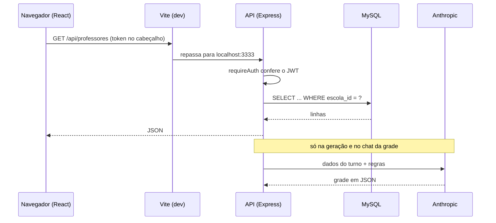
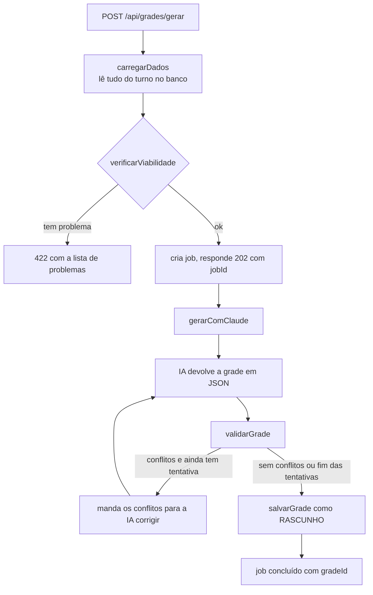
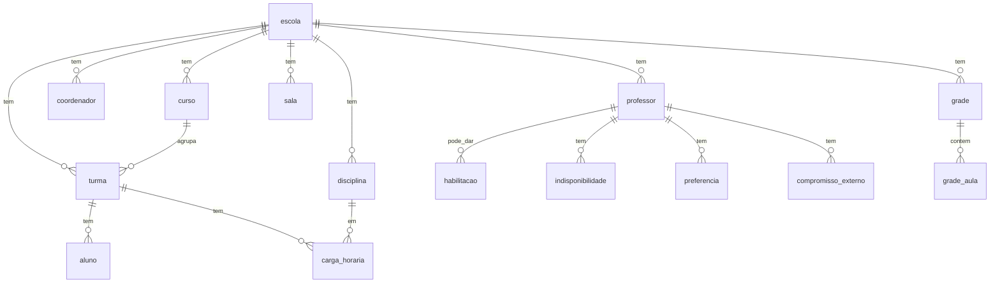

# Estrutura do projeto e funcionamento interno

Este documento mostra como o código do Didáskaros está organizado e o que acontece por baixo quando alguém
usa o sistema: do clique na tela até a consulta no banco e a chamada da IA.

Para a lista de tecnologias, veja [tecnologias-e-funcionamento.md](tecnologias-e-funcionamento.md). Para
cada rota e tabela em detalhe, veja [backend.md](backend.md).

---

## 1. Pastas

```
TCC-Didaskaros-WEB/
├── backend/                 API em Node + Express + TypeScript
│   ├── .env.example         modelo das configurações (banco, JWT, chave da IA)
│   └── src/
│       ├── server.ts        sobe o servidor na porta 3333
│       ├── app.ts           registra middlewares e rotas
│       ├── env.ts           lê o .env e define valores padrão
│       ├── db.ts            pool do MySQL e funções select / exec / transaction
│       ├── http.ts          HttpError, validação com Zod e tratamento de erros
│       ├── auth.ts          login, cadastro de coordenador e middleware requireAuth
│       ├── routes/
│       │   ├── cadastros.ts disciplinas, salas, professores e turmas
│       │   ├── grades.ts    gerar, ajustar, listar, publicar, revalidar e excluir grades
│       │   └── painel.ts    números do Painel Principal
│       ├── grade/
│       │   ├── tipos.ts     tipos da grade, horários dos turnos e regras do CPS
│       │   ├── claude.ts    conversa com a API da Anthropic (Didáskaros IA)
│       │   ├── validador.ts confere conflitos sem depender da IA
│       │   └── validador.test.ts
│       └── scripts/setup-db.ts  recria o banco e insere uma escola de exemplo
│
├── frontend/didaskaros/     telas em React + Vite + Tailwind
│   └── src/
│       ├── main.tsx         ponto de entrada; envolve o app no AuthProvider
│       ├── App.tsx          rotas (React Router)
│       ├── api/             cliente Axios (client.ts) e tipos das respostas (types.ts)
│       ├── auth/            AuthContext: usuário logado, token e proteção das rotas
│       ├── hooks/useApi.ts  useApi (GET com carregando/erro) e useRecurso (CRUD)
│       ├── components/      peças reaproveitadas: Layout, Sidebar, CrudPage, GradeViewer, ChatAjuste...
│       ├── pages/           uma tela por arquivo (Painel, Grades, GerarGrade, Professores...)
│       └── lib/             utilidades: máscaras, formatação, cores das disciplinas
│
├── database/db.sql          criação das tabelas (DDL)
├── design/                  protótipos HTML exportados do design
└── docs/                    documentação
```

---

## 2. Como as três partes conversam



- Em desenvolvimento, o front roda em `localhost:5173` e o Vite encaminha tudo que começa com `/api` para o
  backend (`vite.config.ts`). Por isso o front chama só `/api/...`, sem endereço fixo, e não tem problema de CORS.
- O backend é o único que fala com o banco e com a IA. A chave da Anthropic fica no `backend/.env` e nunca
  chega ao navegador.

---

## 3. Backend por dentro

### 3.1 Caminho de uma requisição

`server.ts` só chama `app.listen`. Toda a montagem fica em `app.ts`:

1. `cors()` e `express.json()` leem o corpo da requisição.
2. `/api/auth` é público (login e cadastro).
3. As outras rotas passam antes pelo `requireAuth`.
4. Se qualquer rota lançar um erro, ele cai no `errorHandler` no fim da cadeia.

O Express 5 já captura erros de funções `async`, então as rotas só fazem `throw new HttpError(404, "...")`
e não precisam de `try/catch`.

### 3.2 Login e sessão (`auth.ts`)

- **Login:** procura o coordenador pelo e-mail e compara a senha com o hash salvo (`bcrypt.compare`). Se der
  certo, gera um JWT com `{ coordenadorId, unidadeId }`, que vale 8 horas, ou 30 dias com "manter conectado".
- **requireAuth:** lê o cabeçalho `Authorization: Bearer <token>`, confere a assinatura com o `JWT_SECRET` e
  coloca o conteúdo em `req.sessao`. Token ausente ou vencido vira 401.
- **Cadastro:** numa transação, cria a escola se ela ainda não existir (`INSERT IGNORE`), cria o curso do
  mesmo jeito (`idCurso`) e grava o coordenador com a senha em hash.

### 3.3 Cada escola só vê os próprios dados

O `unidadeId` vem do token, nunca do corpo da requisição. Toda consulta filtra por ele:

```sql
SELECT ... FROM professor WHERE escola_id = ?
UPDATE turma SET ... WHERE id = ? AND escola_id = ?
```

No `UPDATE` e no `DELETE`, se o id for de outra escola, `affectedRows` volta 0 e a API responde 404.
Quando o corpo traz ids de outras tabelas (disciplinas de um professor, por exemplo), `garantirDaUnidade`
confere se todos pertencem à mesma escola antes de gravar.

### 3.4 Banco (`db.ts`)

Um pool com até 10 conexões. Três funções cobrem tudo:

| Função | Uso |
|---|---|
| `select<T>(sql, params)` | consultas; devolve as linhas já tipadas |
| `exec(sql, params)` | INSERT, UPDATE e DELETE; devolve `insertId` e `affectedRows` |
| `transaction(fn)` | abre uma transação, faz commit se `fn` terminar e rollback se der erro |

Os parâmetros sempre vão com `?`, então o driver escapa os valores e não tem SQL injection. O pool também
converte `DECIMAL` em número e `TINYINT(1)` em `true/false`, para o JSON sair no formato que o front espera.

### 3.5 Validação e erros (`http.ts`)

- `parse(schema, dados)` valida com Zod. Se falhar, responde 400 com a primeira mensagem, já com o nome do
  campo (ex.: `email: E-mail inválido.`).
- O `errorHandler` traduz erros do MySQL: registro duplicado vira 409, excluir algo que está em uso vira 409
  e banco desligado vira 503. O resto vira 500 e é impresso no terminal.
- Toda resposta de erro tem o formato `{ "erro": "mensagem" }`, e o front sempre lê esse campo.

### 3.6 Cadastros (`routes/cadastros.ts`)

- **Disciplinas e salas** são tabelas simples. A função `crudSimples` recebe o nome da tabela, o mapa
  "campo da API → coluna do banco" e o schema Zod, e monta as quatro rotas (listar, criar, editar, excluir).
- **Professores** têm dados ligados: habilitações, indisponibilidades, preferências e compromissos externos.
  Ao salvar, tudo isso é apagado e gravado de novo dentro de uma transação, o que é mais simples do que
  comparar o que mudou. Se um horário estiver marcado como indisponível e como preferido, a indisponibilidade
  vence.
- **Turmas** fazem o mesmo com a carga horária (disciplina, aulas por semana e professor, que é opcional).
  O curso é informado pelo nome e criado na hora se ainda não existir.

### 3.7 Painel (`routes/painel.ts`)

Uma rota só, que junta tudo o que a tela inicial precisa: totais de cada cadastro, contagem de grades por
status, aulas de hoje (só das grades publicadas e só de segunda a sexta) e a carga semanal de cada professor.

---

## 4. Geração da grade

Esta é a parte principal do sistema. Os arquivos envolvidos são `routes/grades.ts`, `grade/claude.ts`,
`grade/validador.ts` e `grade/tipos.ts`.

### 4.1 Passo a passo



1. **Carregar os dados.** `carregarDados` faz várias consultas e monta um objeto `DadosGeracao` com as turmas
   do turno (e a carga horária de cada uma), as disciplinas, as salas e os professores. Cada professor vem com
   habilitações, indisponibilidades, preferências e **ocupações**: aulas que ele já tem em outros turnos do
   mesmo semestre e compromissos em outras unidades.
2. **Checar se é possível.** `verificarViabilidade` pega erros que nenhuma IA resolveria: turma sem carga
   horária, turma com mais aulas do que horários no turno, disciplina sem professor habilitado, nenhuma sala
   grande o bastante, disciplina de laboratório sem laboratório cadastrado. Se aparecer algum, a API responde
   422 com a lista e a IA nem é chamada.
3. **Responder logo.** A IA pode levar alguns minutos, mais do que uma requisição HTTP deveria esperar. Por
   isso a rota cria um *job*, responde `202 { jobId }` na hora e continua o trabalho em segundo plano.
4. **Chamar a IA.** `gerarComClaude` manda as regras no *system prompt* e os dados do turno em JSON. A resposta
   é pedida em formato estruturado (`output_config.format` com o schema Zod), então o retorno é sempre um JSON
   com `aulas` e `observacoes`. A chamada usa streaming para a conexão não cair em respostas longas.
5. **Validar.** `validarGrade` confere a grade que voltou. Se encontrar conflitos, eles são enviados de volta
   na mesma conversa ("corrija e devolva a grade inteira"). São até 3 tentativas, e o sistema guarda a que teve
   menos conflitos.
6. **Salvar.** A grade vai para as tabelas `grade` e `grade_aula` como `RASCUNHO`, junto com as observações da
   IA, os conflitos que sobraram, o modelo usado e o número de tentativas.

### 4.2 Jobs em memória

Os jobs ficam num `Map` dentro do processo do backend:

```ts
{ id, unidadeId, status: "executando" | "concluido" | "erro", etapa, tentativa, gradeId?, resposta?, erro? }
```

- A função de progresso atualiza `etapa` e `tentativa` ("Montando a grade", "Validando conflitos"...).
- O front consulta `GET /api/grades/jobs/:id` a cada 2 segundos.
- Jobs com mais de uma hora são apagados quando um novo começa.
- Como fica em memória, reiniciar o backend perde os jobs em andamento. Para um TCC com um servidor só isso
  basta; em produção daria para usar uma fila (Redis, por exemplo).

### 4.3 O validador

A IA monta a grade, mas quem decide se ela tem conflito é o `validador.ts`, que é código comum e não depende
do modelo. Ele confere:

| Grupo | Regras |
|---|---|
| Choques | turma, professor ou sala em dois lugares no mesmo horário |
| Carga | cada disciplina com o número exato de aulas semanais; mesma disciplina sempre com o mesmo professor |
| Professor | habilitado para a disciplina, respeita a atribuição já feita e as indisponibilidades |
| Sala | laboratório quando a disciplina exige; capacidade para a turma |
| Jornada do CPS | não bate com as ocupações, no máximo 8h por dia, 1h de refeição se passar de 6h, 11h de interjornada e no máximo 30 aulas por semana |

Para as regras de jornada, ele junta as aulas da grade nova com as ocupações do professor, ordena por horário
de cada dia e calcula as pausas e o tempo de descanso de um dia para o outro. Os horários reais de cada aula
vêm de `intervaloAula` em `tipos.ts` (manhã às 7h30, tarde às 13h, noite às 19h, aulas de 50 ou 45 minutos
e intervalo depois da 3ª aula).

Os testes ficam em `validador.test.ts` e rodam com `npm test` dentro de `backend/`.

### 4.4 Chat de ajuste

`POST /api/grades/:id/ajustar` usa o mesmo esquema de job. A diferença está no que vai para a IA:

- os dados do turno, a grade atual, o histórico da conversa e o novo pedido;
- a lista de problemas e avisos dos cadastros, para a IA poder dizer "cadastre um professor de Física".

A IA responde com `{ resposta, alterou, aulas }`. Se `alterou` for falso (foi só uma pergunta), o texto volta
para o chat e nada é salvo. Se for verdadeiro, a grade nova passa pelo validador e é salva como uma **nova**
grade em rascunho, então a versão anterior continua existindo.

### 4.5 Publicar

`PATCH /api/grades/:id/status` com `PUBLICADA`:

- recusa se a grade tiver conflitos;
- numa transação, arquiva a grade que estava publicada no mesmo turno e semestre e publica a nova.

Assim cada turno tem no máximo uma grade publicada por semestre, e é ela que o Painel usa.

---

## 5. Frontend por dentro

### 5.1 Inicialização

```
main.tsx
 └── AuthProvider          guarda o usuário e o token
      └── App (rotas)
           ├── /cadastro   tela pública
           └── RequireAuth exige usuário logado
                └── Layout Sidebar + Topbar + <Outlet/>
                     └── página da rota (Painel, Grades, ...)
```

- `AuthProvider` procura um token salvo ao abrir a página. Se encontra, chama `/api/auth/me` para recuperar
  o usuário.
- **Provisório:** enquanto a tela de Login (da Julia) não está pronta, quando não há token o sistema entra
  direto com a coordenadora de exemplo (`loginProvisorio` em `AuthContext.tsx`). Isso sai quando a rota
  `/login` for ligada.
- Cada rota em `App.tsx` tem um `handle` com o título e a seção, que a `Topbar` lê para montar o cabeçalho.

### 5.2 Cliente da API (`api/client.ts`)

- Uma instância do Axios com `baseURL: "/api"`.
- Um interceptor de requisição coloca o token no cabeçalho `Authorization` de toda chamada.
- Um interceptor de resposta trata o 401: apaga o token e recarrega a página.
- O token fica no `localStorage` com "manter conectado" e no `sessionStorage` sem essa opção (some ao fechar
  a aba).
- `mensagemErro(err)` pega o `erro` que o backend mandou ou mostra uma mensagem genérica se o servidor não
  respondeu.

### 5.3 Buscar e salvar dados

- `useApi(path)` faz o GET e devolve `{ data, erro, carregando, recarregar }`. As páginas não usam
  `useEffect` com Axios direto, usam esse hook.
- `useRecurso(path)` usa o `useApi` e adiciona `salvar` (POST se for novo, PUT se tiver id) e `excluir`.
  Depois de cada alteração ele recarrega a lista.
- `CrudPage` é o molde das telas de cadastro: tabela de um lado e formulário do outro. Disciplinas e Salas são
  quase só a configuração das colunas e dos campos. Professores e Turmas acrescentam partes próprias (quadro
  de horários e tabela de carga horária).

### 5.4 Tela Gerar Grade

1. Ao escolher o turno e as aulas por dia, a tela chama `GET /api/grades/diagnostico` e mostra o que falta
   nos cadastros. Se houver algum problema que impede a geração, o botão de gerar fica bloqueado.
2. Ao clicar em gerar, faz o `POST /api/grades/gerar` e recebe o `jobId`.
3. Um `useEffect` consulta o job a cada 2 segundos até ele terminar ou dar erro.
4. **Barra de progresso:** a API não sabe a porcentagem real, então o front estima. Começa com cerca de 25
   segundos por turma e, depois de cada geração, guarda no `localStorage` a média de segundos por turma, de
   modo que a estimativa melhora com o uso. A barra anda até 85% no tempo previsto e depois vai devagar, sem
   chegar a 100% antes de a resposta chegar. Cada tentativa extra de correção aumenta o tempo previsto.
5. Quando termina, busca a grade completa (`GET /api/grades/:id`) e mostra no `GradeViewer`, que permite ver
   por turma, por professor ou por sala. O `ChatAjuste` aparece embaixo.

### 5.5 Estilo e animações

Tailwind para quase tudo. As animações próprias (destaque que desliza no menu, brilho da barra de progresso e
a abertura depois do login) estão em `index.css` e `tailwind.config.cjs`. A abertura respeita
`prefers-reduced-motion`: se o sistema pedir menos movimento, ela é pulada.

---

## 6. Banco de dados

Resumo das ligações (detalhes em [backend.md](backend.md)):



- Quase toda tabela tem `escola_id`, e é isso que separa os dados de cada escola.
- `grade` guarda os parâmetros da geração e, em colunas JSON, as preferências usadas e os conflitos
  encontrados. `grade_aula` tem uma linha por aula: turma, disciplina, professor, sala, dia (0 a 4) e ordem
  (0 é a primeira aula do turno).
- O MySQL devolve colunas JSON como objeto e o MariaDB como texto. A função `jsonArray` em `grades.ts` trata
  os dois casos.
- `npm run db:setup` apaga e recria o banco a partir do `db.sql` e insere a ETEC de exemplo, com professores,
  turmas, uma indisponibilidade e compromissos externos já cadastrados para testar as regras de jornada.

---

## 7. Configuração

Variáveis do `backend/.env` (o modelo está em `.env.example`):

| Variável | Para que serve | Padrão |
|---|---|---|
| `PORT` | porta da API | 3333 |
| `DB_HOST`, `DB_PORT`, `DB_USER`, `DB_PASSWORD`, `DB_NAME` | conexão com o MySQL | 127.0.0.1, 3306, root, vazio, didaskaros |
| `JWT_SECRET` | assina os tokens de login | valor de desenvolvimento (trocar) |
| `ANTHROPIC_API_KEY` | chave da IA; sem ela a geração responde 503 | nenhum |
| `CLAUDE_MODEL` | modelo usado | `claude-opus-5-5` |
| `CLAUDE_EFFORT` | quanto a IA "pensa" antes de responder | `high` |

Como rodar o projeto está explicado no [README](../README.md).
