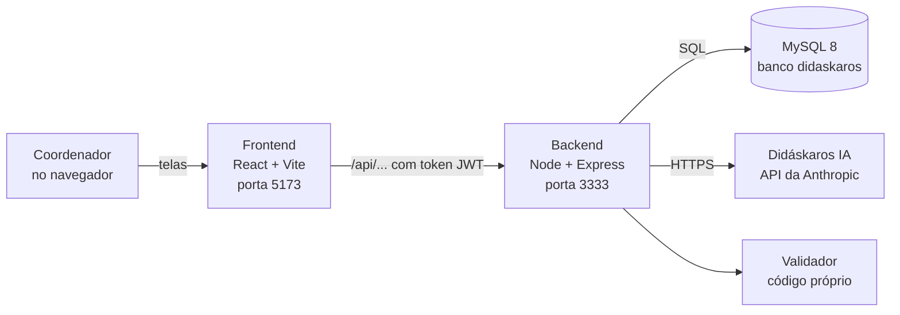
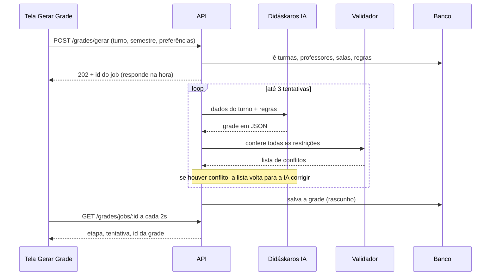

# Didáskaros: tecnologias e funcionamento

Este documento explica o que o Didáskaros usa e o que acontece por trás da tela quando o coordenador
cadastra dados, gera uma grade ou conversa com a Didáskaros IA. Os detalhes de cada rota e tabela estão
em [backend.md](backend.md).

---

## Visão geral

O sistema tem três partes que rodam separadas:



- **Frontend**: as telas. Não guarda dados; tudo vem da API.
- **Backend**: a API. Recebe os pedidos, confere o login, lê e grava no banco, chama a IA e roda o validador.
- **Banco**: guarda escola, cursos, professores, turmas, disciplinas, salas e as grades geradas.
- **Didáskaros IA**: é o nome que o sistema dá ao modelo Claude, da Anthropic. Ele é chamado pela API da
  Anthropic. A IA monta a grade, e um validador escrito por nós confere se ela não tem conflitos.

---

## Tecnologias

### Frontend (`frontend/didaskaros`)

| Tecnologia | Para que serve |
|---|---|
| React 19 | Biblioteca das telas, montadas em componentes reaproveitáveis |
| TypeScript | JavaScript com tipos; acusa erros antes de rodar |
| Vite 8 | Servidor de desenvolvimento e build; encaminha `/api` para o backend |
| React Router 7 | Navegação entre as páginas sem recarregar |
| Tailwind CSS 3 | Estilos escritos direto nas classes dos componentes, incluindo as animações |
| Axios | Faz as chamadas HTTP para a API e anexa o token de login |

### Backend (`backend`)

| Tecnologia | Para que serve |
|---|---|
| Node.js 20.19+ | Roda o JavaScript no servidor |
| Express 5 | Organiza as rotas da API |
| TypeScript + tsx | Tipagem e execução direta dos arquivos `.ts` |
| mysql2 | Conexão com o MySQL, com pool de conexões e transações |
| Zod | Valida os dados que chegam nas rotas e o formato da resposta da IA |
| jsonwebtoken (JWT) | Gera e confere o token de login |
| bcryptjs | Guarda a senha do coordenador como hash, nunca em texto |
| @anthropic-ai/sdk | Biblioteca oficial para chamar a API da Anthropic (Didáskaros IA) |
| node:test | Testes automatizados do validador (`npm test`) |

### Banco de dados (`database/db.sql`)

MySQL 8 (também funciona em MariaDB). São 15 tabelas, seguindo o diagrama ER do projeto:

- **Cadastros:** `escola`, `curso`, `coordenador`, `professor`, `turma`, `aluno`, `disciplina` e `sala`.
- **Ligações e regras do professor:**
  - `carga_horaria` (o relacionamento Leciona)
  - `habilitacao`
  - `indisponibilidade`
  - `preferencia`
  - `compromisso_externo`
- **Grades:** `grade` e `grade_aula`.

### IA

| Item | Valor |
|---|---|
| Modelo | `claude-opus-5-5` (troca em `CLAUDE_MODEL` no `.env`) |
| Esforço | `high` (troca em `CLAUDE_EFFORT`) |
| Formato da resposta | JSON estruturado, conferido com Zod |
| Recusa por engano | O parâmetro `fallbacks: "default"` refaz o pedido em outro modelo |

---

## Como funciona por trás dos panos

### 1. Login

1. O coordenador manda e-mail e senha para `POST /api/auth/login`.
2. O backend compara a senha com o hash bcrypt guardado no banco.
3. Se bater, devolve um **token JWT** com o id do coordenador e o id da escola.
4. O frontend guarda o token e o Axios o envia em toda chamada (`Authorization: Bearer ...`).
5. Toda rota (menos login e cadastro) passa pelo `requireAuth`, que confere o token. Cada consulta ao banco filtra
   pela escola do token: um coordenador nunca vê os dados de outra unidade.

> **Provisório:** a tela de Login é da Julia. Até ela chegar, o frontend entra sozinho com a coordenadora do banco
> de exemplo (`frontend/didaskaros/src/auth/AuthContext.tsx`, função `loginProvisorio`).

### 2. Cadastros

Professores, turmas, disciplinas e salas usam o mesmo componente (`components/CrudPage.tsx`): tabela à esquerda,
formulário à direita. Salvar chama `POST` (novo) ou `PUT` (edição), e excluir chama `DELETE`. O backend valida com Zod
e grava em transação. Por exemplo, o professor e as habilitações, indisponibilidades, preferências e compromissos
dele são gravados juntos ou nada é gravado.

### 3. Diagnóstico: a IA avisa o que falta

Ao abrir Gerar Grade, o frontend chama `GET /api/grades/diagnostico?turno=...`. O backend lê os cadastros do turno
e devolve duas listas:

- **Problemas** (impedem a geração):
  - turma sem carga horária;
  - turma com mais aulas que horários;
  - nenhuma sala que caiba a turma;
  - disciplina sem professor habilitado;
  - disciplina de laboratório sem laboratório;
  - professor acima de 30 aulas na semana.
- **Avisos** (vale conferir):
  - professor sem disciplina;
  - disciplina com um único professor possível;
  - turma com carga horária muito baixa.

A tela mostra as duas listas com atalhos para as telas de cadastro. O botão Gerar fica bloqueado enquanto houver
problema. Essa verificação é feita por código, não pela IA, então é instantânea e não gasta nada.

### 4. Geração da grade



Pontos importantes:

- **O turno inteiro é gerado de uma vez.** As turmas disputam os mesmos professores e salas; gerar uma por uma
  faria a ordem decidir quem fica com os piores horários.
- **Os outros turnos entram na conta.** Ao gerar a manhã, o backend envia as aulas que cada professor já tem na
  tarde e na noite (grade publicada ou rascunho mais recente). Assim as regras de 11h de descanso e de 8h por dia
  valem entre turnos.
- **O job roda em segundo plano.** O `POST` responde na hora com um id, e a tela consulta o andamento a cada 2s. Os
  jobs ficam na memória do servidor por 1 hora.
- **Barra de progresso:** o backend informa a etapa (preparando, montando, validando, corrigindo) e a tela calcula a
  porcentagem e o tempo restante. A estimativa começa em 25 s por turma e se ajusta com a média das gerações
  anteriores, guardada no navegador.

### 5. O validador

O validador está em `backend/src/grade/validador.ts` e não usa IA. Ele recebe a grade pronta e confere cada
restrição dura:

- turma, professor e sala em um só lugar por horário;
- carga horária cumprida;
- professor habilitado;
- mesmo professor na disciplina a semana toda;
- indisponibilidade respeitada;
- laboratório quando a disciplina exige;
- capacidade da sala;
- regras de jornada do CPS:
  - compromisso externo;
  - 11 h entre jornadas;
  - 8 h por dia;
  - 1 h de refeição acima de 6 h;
  - 30 aulas por semana.

Por que a IA e o validador são separados: o modelo pode errar, e o validador garante o "zero conflitos". Uma grade
com conflito pode ser vista, mas **não pode ser publicada** (o backend recusa). Os 20 testes automatizados ficam em
`validador.test.ts`.

### 6. Conversa com a IA: ajuste da grade

Depois de gerar, aparece abaixo da grade o quadro **Ajustar com a Didáskaros IA**. O coordenador escreve o que
quer, por exemplo "passe a Matemática da 1DS de segunda para quarta" ou "por que a Física ficou na quinta?".

1. A tela envia o pedido e a conversa anterior para `POST /api/grades/:id/ajustar`.
2. O backend junta tudo para a IA:
   - os dados do turno;
   - a grade atual;
   - a conversa até aqui;
   - os problemas de cadastro do diagnóstico.
3. A IA devolve uma resposta em texto e diz se alterou a grade.
   - **Só pergunta:** a resposta aparece no chat e nada muda.
   - **Alteração:** a IA devolve a grade inteira com a menor mudança possível. Ela passa pelo validador, e os
     conflitos voltam para correção como na geração.
   - **Pedido impossível** (quebraria uma regra): a IA explica qual regra impede e sugere uma alternativa.
   - **Precisa de cadastro** (professor novo, indisponibilidade, carga horária): a IA diz o que cadastrar e em qual
     tela. **A IA não altera cadastros**: quem cadastra, edita e exclui é sempre o coordenador.
4. Cada ajuste salvo vira uma **nova versão em rascunho**, e a anterior continua no histórico. A tela passa a mostrar
   a versão nova, e o coordenador decide se publica.

### 7. Publicação e versões

Cada grade tem um status: rascunho, publicada ou arquivada. Ao publicar, a grade publicada anterior do mesmo turno e
semestre vai para o arquivo. Fica no máximo uma publicada por turno. O Painel e a tela de Grades leem daí.

---

## Estrutura do código

```
backend/src/
  app.ts, server.ts      rotas e inicialização
  auth.ts                login, JWT, cadastro de coordenador
  db.ts, http.ts, env.ts banco, erros/validação, configurações
  routes/cadastros.ts    professores, turmas, disciplinas, salas
  routes/grades.ts       gerar, diagnóstico, ajustar, jobs, publicar, validar
  routes/painel.ts       números do Painel
  grade/claude.ts        chamadas à Didáskaros IA (geração e ajuste)
  grade/validador.ts     restrições duras e diagnóstico de cadastros
  grade/tipos.ts         tipos, horários dos turnos e constantes do CPS

frontend/didaskaros/src/
  pages/                 Painel, GerarGrade, Grades, Professores, Turmas, Disciplinas, Salas, Cadastro
  components/            Layout, Sidebar, Topbar, CrudPage, GradeViewer, ChatAjuste, ui, form
  api/                   cliente Axios e tipos das respostas
  auth/AuthContext.tsx   sessão do coordenador
  lib/                   formatação, máscaras, cores, nome da IA
  assets/                logo oficial
```

---

## Como rodar

1. MySQL rodando e o arquivo `backend/.env` com a senha do banco e a `ANTHROPIC_API_KEY`.
2. `cd backend`, depois `npm install` e `npm run db:setup`. Isso **apaga** o banco e cria os dados de exemplo.
3. `npm run dev` dentro de `backend/`.
4. `cd frontend/didaskaros`, depois `npm install` e `npm run dev`. Abra o endereço que aparecer (normalmente
   http://localhost:5173).

---

## Limitações conhecidas

- **Jobs só na memória:** se o backend reiniciar no meio de uma geração, ela se perde. A grade já salva não se perde.
- **Login provisório** até a tela da Julia.
- **Limite de 30 aulas por semana:** veio de fonte secundária e precisa de confirmação (`aulasSemanaisMax` em
  `backend/src/grade/tipos.ts`).
- **Escala:** em uma unidade grande (cerca de 40 turmas), a IA pode não fechar a grade sem conflitos em 3
  tentativas. A alternativa registrada em [tarefas-gerar-grade.md](tarefas-gerar-grade.md) é trocar o gerador por
  um solver de restrições, mantendo o mesmo validador.
- **Custo:** cada geração e cada ajuste é uma chamada paga à API da Anthropic. O diagnóstico e o validador não
  custam nada.
